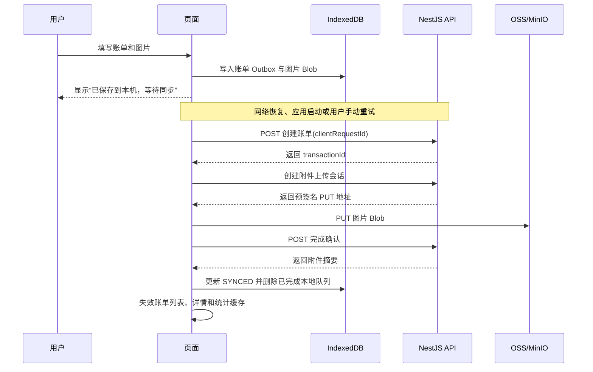

# 小宝记账前端离线与本地缓存设计

## 1. 文档定位

本文定义 Next.js App Router + React + TanStack Query + Zustand + PWA 前端的离线新增、本地数据缓存、图片 Blob 缓存和同步队列实现边界。

产品规则以《离线记账与本地缓存需求》为准，账单和附件接口以现有 API 文档、DTO 和 Swagger 为准。本文不增加新的服务端账单模型，不把本地缓存当作服务端权限边界。

## 2. 现状与问题

### 2.1 当前技术事实

| 能力 | 当前实现 | 缺口 |
| --- | --- | --- |
| 网络状态 | `useOnlineStatusSync` + `offlineStore` | 只有状态展示，没有持久化 Outbox |
| 查询缓存 | TanStack Query 内存缓存 | 页面刷新后缓存丢失，未建立 IndexedDB 快照层 |
| PWA | Service Worker 缓存页面壳和静态资源 | 没有业务数据离线同步能力 |
| 离线记账 | 断网时禁止提交 | 需要支持离线新增和恢复网络同步 |
| 图片上传 | 内存中的并发队列 | 刷新、关闭应用或 PWA 重启后图片草稿丢失 |
| 图片读取 | 请求短期签名 URL | 每次详情打开可能重复请求和下载 |
| 账单详情 | `staleTime: 0` | 可以增加“本地快照先展示、在线后台刷新”能力 |

### 2.2 设计问题

1. Zustand、TanStack Query、IndexedDB 和 Service Worker 的职责需要明确分层。
2. 账单创建请求与图片上传请求存在依赖：图片上传需要先获得服务端 `transactionId`。
3. 共享账本的权限和并发状态只能由服务端最终确认，本地不能把预校验结果当成授权。
4. 签名 URL 是短期凭证，不适合作为持久缓存对象；需要缓存已下载的图片 Blob。
5. 用户、账本和附件数据必须隔离清理，避免退出账号后显示旧用户信息。

## 3. 推荐方案

采用四层数据结构：

```text
页面组件
  ↓
TanStack Query：请求状态、内存缓存、失效和后台刷新
  ↓
领域缓存适配层：在线请求与 IndexedDB 快照之间的协调
  ↓
IndexedDB：账单 Outbox、查询快照、附件队列、图片 Blob

Service Worker：只负责静态资源和页面壳，不缓存账单 API 或签名 URL
Zustand：只负责在线状态、同步状态、当前用户和当前账本等客户端状态
```

核心原则：

1. 服务端是账单、权限、余额和统计的最终事实来源。
2. 本地账单必须带有明确的本地同步状态。
3. 所有本地记录按 `userId + ledgerId` 隔离。
4. 查询缓存负责快速渲染，IndexedDB 负责跨刷新和 PWA 重启保存。
5. 图片缓存保存 Blob 和元数据，不保存长期可用的签名 URL。
6. Service Worker 不参与财务数据同步，避免认证、权限和清理边界分散。

## 4. 状态职责

### 4.1 Zustand

`offlineStore` 只保存轻量、可恢复的运行状态：

```ts
type SyncStatus = 'idle' | 'syncing' | 'succeeded' | 'failed' | 'conflict';

interface OfflineRuntimeState {
  isOnline: boolean;
  syncStatus: SyncStatus;
  pendingCount: number;
  lastError: string | null;
}
```

不把完整账单、图片 Blob、访问令牌、Outbox payload 写入 Zustand 或 localStorage。

### 4.2 TanStack Query

TanStack Query 管理：

- 当前页面查询状态；
- 请求去重和内存缓存；
- 列表分页和筛选；
- 在线状态下的后台刷新；
- 账单写入后的列表、统计和详情失效；
- 从 IndexedDB 快照恢复的初始数据。

普通用户查询键继续使用已有的 `['ledger', ledgerId, ...]` 约定。持久化数据必须额外绑定 `userId`，不能只用 Query key 判断归属。

### 4.3 IndexedDB

建议新增一个统一数据库，例如 `xiaobao-jizhang-local`，通过版本迁移维护对象仓库：

| Object Store | 用途 | 关键键 |
| --- | --- | --- |
| `transaction-outbox` | 离线新增账单 | `userId + ledgerId + localId` |
| `attachment-outbox` | 待上传图片 Blob | `userId + ledgerId + localId` |
| `query-snapshots` | 账本、分类、账户、成员和账单列表快照 | `userId + ledgerId + queryKey` |
| `transaction-details` | 已打开账单详情 | `userId + ledgerId + transactionId` |
| `attachment-blobs` | 已查看或刚上传成功的图片 | `userId + ledgerId + attachmentId` |
| `cache-metadata` | 最近访问时间、大小、版本和清理信息 | `userId + namespace` |

建议使用独立的 `lib/offline/storage.ts` 封装 IndexedDB。页面和业务 API 不直接调用 `indexedDB`，便于测试、错误降级和后续切换实现。

## 5. 本地数据模型

### 5.1 账单 Outbox

```ts
interface OfflineTransactionRecord {
  localId: string;
  userId: string;
  ledgerId: string;
  clientRequestId: string;
  payload: CreateTransactionInput;
  attachmentLocalIds: string[];
  status: 'PENDING' | 'SYNCING' | 'SYNCED' | 'FAILED' | 'CONFLICT';
  transactionId: string | null;
  retryCount: number;
  lastError: { code: string | number | null; message: string } | null;
  createdAt: string;
  updatedAt: string;
}
```

`payload` 必须是可序列化的 JSON，不保存 React 状态、File 对象或临时 Object URL。创建账单时生成的 `clientRequestId` 贯穿整个重试生命周期。

### 5.2 图片待上传记录

```ts
interface OfflineAttachmentRecord {
  localId: string;
  userId: string;
  ledgerId: string;
  transactionLocalId: string;
  clientRequestId: string;
  blob: Blob;
  fileName: string;
  mimeType: string;
  sizeBytes: number;
  status: 'LOCAL' | 'UPLOADING' | 'ATTACHED' | 'FAILED';
  attachmentId: string | null;
  lastError: string | null;
  createdAt: string;
  updatedAt: string;
}
```

`previewUrl` 只在运行时生成，不能写入 IndexedDB。应用恢复时由 Blob 重新生成，并在组件卸载或记录删除后调用 `URL.revokeObjectURL()`。

### 5.3 图片 Blob 缓存

```ts
interface AttachmentBlobCacheRecord {
  cacheKey: string;
  userId: string;
  ledgerId: string;
  attachmentId: string;
  blob: Blob;
  mimeType: string;
  sizeBytes: number;
  lastAccessedAt: string;
  createdAt: string;
}
```

附件完成后内容不可修改，`attachmentId` 可以作为内容标识。附件被删除时删除对应 Blob；如果未来支持替换附件，需要增加服务端版本或内容摘要并纳入缓存键。

## 6. 离线创建与同步数据流



### 6.1 同步执行器

建议新增 `lib/offline/sync-engine.ts`，职责包括：

- 读取当前登录用户的待同步记录；
- 按 `createdAt` 顺序逐条提交账单；
- 同一账本内串行提交，避免用户误以为本地顺序已经被服务端打乱；
- 成功后依赖 `transactionId` 上传附件；
- 区分可重试错误和需要人工处理的错误；
- 更新 `offlineStore` 的计数、状态和错误摘要；
- 使用互斥锁避免多个页面、多个 `online` 事件同时消费同一队列。

同步执行器不能直接依赖 `navigator.onLine` 判断请求成功。`navigator.onLine` 只作为触发信号，实际请求结果才是网络状态判断依据。

### 6.2 失败处理

| 错误类型 | 执行器动作 | 是否自动重试 |
| --- | --- | --- |
| 网络异常、超时、502/503/504 | 恢复 `PENDING`，增加重试次数 | 是，需退避 |
| 401 | 暂停队列，交给普通用户认证边界处理 | 登录后继续 |
| 40321、40421 | `FAILED`，保留服务端错误码 | 否 |
| 40922 | `CONFLICT`，保留本地 payload | 否，等待用户处理 |
| 附件上传 4xx | 账单保持已同步，附件单独 `FAILED` | 由用户重试 |
| IndexedDB 读写失败 | 停止本轮同步，展示本地存储错误 | 用户重试 |

重试使用指数退避并设置上限，例如 1 秒、5 秒、30 秒、5 分钟；超过自动重试上限后保持待处理状态并提供手动重试。

## 7. 查询缓存与本地快照

### 7.1 读取策略

在线读取使用“缓存先展示、后台重新验证”：

1. TanStack Query 先使用当前内存数据；
2. 页面刷新或内存无数据时，从 IndexedDB 读取允许持久化的快照；
3. 有网络时请求服务端；
4. 服务端成功后更新 TanStack Query 和 IndexedDB；
5. 服务端失败时保留快照，并显示缓存时间和错误提示。

离线读取使用本地快照，但不把缓存结果标记为实时服务端数据。

### 7.2 缓存策略矩阵

| 数据 | 内存 `staleTime` | 本地持久化 | 建议保留范围 | 备注 |
| --- | ---: | --- | --- | --- |
| 分类 | 5 分钟 | 是 | 当前账本启用分类 | 离线表单需要 |
| 账户 | 5 分钟 | 是 | 当前账本可见账户摘要 | 余额仅供展示 |
| 成员 | 5 分钟 | 是 | 当前账本活跃成员摘要 | 付款人选择需要 |
| 账本信息 | 1 分钟 | 是 | 当前用户账本 | 需显示缓存时间 |
| 账单列表 | 30 秒 | 是 | 最近 200～500 条或当前月 | 分页快照需合并去重 |
| 账单详情 | 30 秒～2 分钟 | 按需 | 用户实际打开过的详情 | 在线后台刷新 |
| 统计 | 30 秒 | 默认否 | 不持久化或仅短期快照 | 不合并待同步账单 |
| 签名 URL | 仅内存 | 否 | 无 | 过期后重新申请 |
| 图片 Blob | 不适用 | 是 | 用户查看过的图片 | LRU 和容量上限 |

详情接口当前 `staleTime: 0`。改造后仍需在编辑、删除和权限变化后主动失效；短暂缓存只用于减少重复打开请求，不能屏蔽共享账本中的服务端变更。

### 7.3 本地账单和服务端账单合并

默认账单列表读取时按以下顺序合并：

1. 读取服务端列表快照；
2. 读取当前账本的 `PENDING`、`SYNCING`、`FAILED`、`CONFLICT` 本地账单；
3. 只在筛选条件能由本地 payload 判断时加入本地记录；
4. 本地记录按 `occurredAt` 和 `createdAt` 插入对应日期组；
5. 如果本地记录已经有 `transactionId`，以服务端记录为准并移除本地副本。

统计接口结果不叠加本地账单。页面可以单独显示“待同步金额”，避免前端生成一套与服务端不一致的统计口径。

## 8. OSS 图片缓存

### 8.1 读取流程

```text
打开账单详情
  ├─ 详情快照命中 → 立即渲染元数据
  ├─ attachment-blobs 命中 → 生成 Object URL 展示
  ├─ Blob 未命中且在线 → 请求 access-url → 下载 Blob → 写入 IndexedDB
  └─ Blob 未命中且离线 → 显示离线不可用，可在线后重试
```

签名 URL 只作为一次性下载地址使用，不进入 Service Worker Cache Storage 或 IndexedDB。附件读取失败时不能触发普通用户认证刷新，因为对象存储 PUT/GET 使用 `credentials: omit`。

### 8.2 缓存清理

- 以 `navigator.storage.estimate()` 读取可用空间和使用量；
- 设置应用级图片缓存上限，默认值待产品确认；
- 新写入超过上限时按 `lastAccessedAt` 从旧到新删除；
- 退出登录时删除当前用户的附件 Blob 和查询快照；
- 账本被移除或成员关系失效时删除该账本缓存；
- 服务端返回附件删除或账单不可见时删除本地图片；
- 清理失败只记录错误，不阻塞在线账单操作。

## 9. 用户隔离与认证边界

1. IndexedDB 所有业务记录必须包含 `userId` 和 `ledgerId`。
2. 普通用户和管理员使用不同的数据库命名空间或统一数据库中的不同前缀。
3. 退出登录时先停止同步执行器，再清理当前用户缓存和图片；清理完成后跳转登录页。
4. 401 只清理普通用户域，不影响管理员域；管理员数据不进入离线队列。
5. 登录后如果当前用户 ID 与本地缓存所属用户不一致，禁止 hydrate 旧缓存。
6. 本地缓存不能作为访问权限判断；页面展示缓存后仍需在在线状态下重新请求并接受服务端拒绝。

## 10. PWA 与 Service Worker 边界

Service Worker 继续只缓存：

- 页面壳；
- JS、CSS 和字体；
- manifest、图标等静态资源。

Service Worker 不缓存：

- `/api/auth/*`；
- 普通用户账单、账户、成员、统计和个人资料 API；
- 管理端 API、审计日志和用户治理数据；
- OSS/MinIO 签名 URL 和图片响应。

离线业务数据由 IndexedDB 负责。Background Sync 可以作为 Android 浏览器的增强能力评估，但不能作为核心依赖；iOS Safari 和 iOS PWA 以应用恢复网络、回到前台或重新打开后同步为准。

## 11. 前端模块规划

```text
frontend/src/lib/offline/
├── storage.ts                 IndexedDB 初始化、迁移和读写封装
├── storage-types.ts           Outbox、快照和附件缓存类型
├── sync-engine.ts             离线账单与附件同步执行器
├── sync-lock.ts               页面级同步互斥锁
├── query-snapshot.ts          TanStack Query 与快照协调
├── attachment-cache.ts        图片 Blob 读取、写入、LRU 和 Object URL
└── cache-cleanup.ts           退出登录、切换账本和容量清理

frontend/src/store/
└── offlineStore.ts            运行时在线和同步状态
```

API 适配层继续负责 HTTP 请求和错误类型，不能把 IndexedDB 逻辑直接塞进 `transaction-api.ts` 或 `attachment-api.ts`。组件只调用领域 Hook 或同步服务，不能自行读写数据库。

## 12. 实施阶段

| 阶段 | 内容 | 产出 |
| --- | --- | --- |
| 1 | IndexedDB 封装、用户/账本隔离、Outbox 类型 | 可读写本地数据的基础模块 |
| 2 | 离线新增账单和同步执行器 | 账单断网保存、联网同步、重试和失败状态 |
| 3 | 图片待上传队列持久化 | 账单同步后上传附件，刷新后可继续 |
| 4 | 查询快照与账单详情缓存 | 刷新后显示近期账单和详情快照 |
| 5 | 图片 Blob 缓存与 LRU | 常用附件重复打开不再重复下载 |
| 6 | 清理、容量提示和 PWA/真机验收 | 用户隔离、存储不足和移动端稳定性 |

每个阶段都需要就近补充单元测试或契约测试。涉及登录跳转、PWA 生命周期和跨页面同步时，再增加 Playwright 或真机验证。

## 13. 测试设计

### 13.1 纯逻辑与存储

- Outbox 状态转换和错误分类；
- 重试退避与自动重试上限；
- 用户、账本和附件缓存键；
- 服务端列表与本地待同步账单合并去重；
- LRU 容量清理；
- Object URL 创建和释放；
- IndexedDB 不可用、读写失败和版本迁移。

### 13.2 API 与同步

- 创建账单请求方法、URL、payload 和 `clientRequestId`；
- 网络恢复时按顺序消费 Outbox；
- 并发触发只执行一个同步器；
- 401 暂停并交给认证边界；
- 403、404、409 的状态映射；
- 账单成功后再创建附件上传会话；
- 附件单张失败不回滚已同步账单。

### 13.3 页面和端到端

- 离线保存后的待同步状态和页面提示；
- 本地快照展示与缓存时间提示；
- 详情图片 Blob 命中和签名 URL 失效后的降级；
- 退出账号后清理旧用户数据；
- PWA 重启后恢复 Outbox；
- iOS Safari、iOS PWA、Android Chrome 和 Android PWA 的网络恢复流程。

## 14. 取舍与风险

### 14.1 推荐方案的收益

- Outbox 沿用现有 `clientRequestId`，不增加离线专用后端接口；
- IndexedDB 可以保存 Blob，适合图片和结构化账单；
- TanStack Query 继续负责页面请求状态，Zustand 不会膨胀成服务端数据库；
- Service Worker 边界清晰，财务数据清理和用户隔离集中在业务层；
- 先实现离线新增，避免同时解决版本冲突、权限变化和删除语义。

### 14.2 风险

- 浏览器和 PWA 可能清理本地存储，未同步数据不具备永久保存保证；
- IndexedDB 中的财务数据和图片没有应用层加密；
- 共享账本权限可能在离线期间变化，导致同步失败；
- 本地待同步账单与服务端统计分离，页面需要清晰展示两个口径；
- iOS 不保证后台同步，用户可能需要重新打开应用完成同步；
- 图片缓存会增加设备空间占用，需要容量上限和清理策略。

## 15. 未决问题

1. 是否引入 `idb` 等轻量 IndexedDB 封装库，还是维护项目内原生 Promise 封装。
2. 图片缓存默认上限和账单快照默认数量需要产品确认。
3. 待同步账单的本地删除和冲突处理页面是否在第一阶段提供。
4. 是否允许用户手动清理缓存，并区分“清理图片”“清理已同步账单快照”和“清理全部本地数据”。
5. 是否需要服务端为附件增加内容摘要或版本字段，以支持未来附件替换后的缓存失效。
