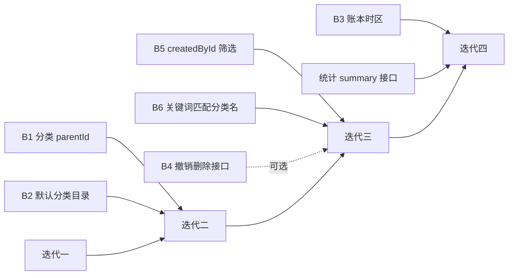

# 一期前端迭代计划

## 1. 迭代划分原则

- 每个迭代结束时页面**可独立验收**，不留半成品入口。
- 后端缺口在对应迭代开始前解决；未解决时明确降级口径并记录技术债。
- 每个迭代都要有可执行的验证动作，不以「类型检查通过」作为唯一证据。

## 2. 迭代一：账单页只读

**目标**：`/user` 从演示页变为真实账单页，用户能看到本月的真实流水。

**后端前置**：无。概览用前端聚合兜底（已知降级）。

### 2.1 任务

| # | 任务 | 产出 |
| --- | --- | --- |
| 1.1 | 新增 `transaction-api.ts` 与 `transaction-types.ts`，接 `GET /transactions` | 列表可请求 |
| 1.2 | 扩展 `query-config.ts`：`queryKeys.transactions(ledgerId, filter)` + `normalizeFilter` | 缓存键稳定 |
| 1.3 | `lib/bill/bill-group.ts` + 单测：按账本时区分组、每日合计 | 纯函数通过测试 |
| 1.4 | `MonthSummaryCard`：总支出/总收入/结余 | 概览展示 |
| 1.5 | `LedgerTopBar`：账本名 + 月份切换 | 月份可切换 |
| 1.6 | `BillDayCard` + `BillRow` | 日期分组渲染 |
| 1.7 | `useInfiniteQuery` 分页 + `IntersectionObserver` | 滚动加载 |
| 1.8 | 空态/错误态/首次加载骨架（`BillListSkeleton`） | 三态齐全 |
| 1.9 | 改造 `/user` 页接入上述组件，移除硬编码金额与 `alert` | 旧演示逻辑删除 |
| 1.10 | `AmountDisplay` 颜色改用语义 token；清理 `ios-blue` 无效类名 | 样式修复 |

### 2.2 验收

- 打开 `/user` 显示当前账本当月真实账单，按日期从新到旧分组。
- 同日多笔在同一卡内，每行有分类名、时间、金额，支出带 `-`、收入带 `+`。
- 切换月份后概览与列表同步变化。
- 账本无账单时显示空态，不显示 0 元日期卡。
- 请求失败显示错误态并可重试，不清空已加载数据。
- 单测覆盖 `bill-group.ts` 的跨 UTC 日界场景。

### 2.3 已知降级

- 概览为前端累加已加载页；`hasNextPage` 为真时显示「已统计前 N 笔」。
- 分类图标用名称首字映射。

## 3. 迭代二：记账抽屉

**目标**：从账单页右下角能真实创建账单，数据落库。

**后端前置**：B1（`Category.parentId`）、B2（16 条默认分类）。

### 3.1 任务

| # | 任务 | 产出 |
| --- | --- | --- |
| 3.1 | `BottomSheet` 原语：portal、焦点管理、`onBeforeClose`、层级 | 可复用面板 |
| 3.2 | `CreateBillFab`：按 `memberRole` 显隐 | 入口就位 |
| 3.3 | `category-api.ts` + `account-api.ts` + `ledger-member-api.ts` | 选择器数据源 |
| 3.4 | `SheetTypeSegment`：支出/收入切换，切换时清空分类 | 类型切换 |
| 3.5 | `CategoryPickerSheet`：两级分类，一级可直选 | 分类选择 |
| 3.6 | `AmountKeypad` 扩展「保存并继续」槽位 | 双提交 |
| 3.7 | `BillCreateSheet`：表单 reducer、校验、`clientRequestId` 生成 | 创建可用 |
| 3.8 | 日期时间选择（原生 `datetime-local` 一期方案） | 可改时间 |
| 3.9 | 未保存内容关闭确认；提交中禁用；失败保留输入 | 交互完整 |
| 3.10 | 创建成功后 `invalidateQueries` + 列表刷新 | 数据同步 |

### 3.2 验收

- 点击 FAB 弹出底部抽屉，默认选中支出，键盘可输入金额（最多两位小数）。
- 切换收入后分类被清空，金额保留。
- 一级分类有二级时进入面板可选二级，也可直接选一级。
- 未选分类或金额为 0 时完成键不可提交，并定位到对应字段。
- 保存成功后抽屉关闭，列表与概览立即出现新账单。
- 保存并继续：抽屉保持打开，金额/商家/备注清空，类型/时间/分类/账户保留。
- 断网提交失败：输入保留，显示错误，不出现成功状态。
- 重复点击提交不会产生两条账单（同一 `clientRequestId`）。

## 4. 迭代三：明细管理

**目标**：能查看、编辑、删除账单，并按条件筛选。

**后端前置**：B5（`createdById` 筛选）、B6（关键词匹配分类名）；B4 视产品结论。

### 4.1 任务

| # | 任务 | 产出 |
| --- | --- | --- |
| 4.1 | `BillDetailSheet`：字段展示 + 成员昵称映射 | 详情可用 |
| 4.2 | 编辑模式：回填、`version` 提交、409 冲突处理 | 编辑可用 |
| 4.3 | 删除：角色判断（`OWNER` 全部 / `EDITOR` 仅自己）、确认弹窗 | 删除可用 |
| 4.4 | `Toast` + 5 秒撤销（依赖 B4） | 撤销或降级为直接删除 |
| 4.5 | `BillFilterSheet`：日期范围、类型、分类、记账人 | 筛选可用 |
| 4.6 | 搜索框：确认后提交，清空恢复 | 搜索可用 |
| 4.7 | 已生效条件胶囊 + 清除全部 | 条件可视化 |
| 4.8 | 返回列表保留筛选与滚动位置 | 体验闭环 |

### 4.2 验收

- 详情区分发生时间与创建时间，显示记账人；有付款人时显示付款人。
- `VIEWER` 不显示编辑/删除入口；`EDITOR` 删除他人账单被拒绝。
- 编辑保存成功后列表、日合计、概览同步更新。
- 他人先修改后提交旧版本，提示「账单已更新」，不覆盖。
- 组合筛选后概览与列表遵守同一条件；清除关键词不影响其他条件。
- 从详情返回列表，筛选条件与滚动位置保留。

## 5. 迭代四：收尾

**目标**：口径统一与体验打磨。

**后端前置**：B3（`Ledger.timezone`）、统计 `summary` 接口。

### 5.1 任务

| # | 任务 | 产出 |
| --- | --- | --- |
| 5.1 | 时区从 `ledger.timezone` 读取，替换硬编码常量 | 口径统一 |
| 5.2 | 接入后端概览接口，删除前端累加与 `isPartial` 分支 | 降级逻辑清除 |
| 5.3 | `SyncStatusBar` 绑定真实 `online`/`offline` 事件 | 离线提示生效 |
| 5.4 | 暗色变量补齐（不启用开关） | 色板完整 |
| 5.5 | 无障碍回归：焦点、`aria`、键盘遍历 | 可访问 |
| 5.6 | 删除死代码：`FoundationDashboard`、`AppShell`、无用 `lib/api.ts` 门面、`offlineStore`（若确认不用） | 减重 |

### 5.2 验收

- 跨时区设备访问同一账单，日期分组一致。
- 概览数值与列表完全一致，不再有「已统计前 N 笔」提示。
- 断网时顶部出现明确提示，记账入口提示不可用。
- `grep -r "FoundationDashboard\|AppShell\|ios-blue\|animate-in" frontend/src` 零命中。

## 6. 依赖关系

迭代一、二、三、四严格串行：后者依赖前者的页面结构与数据层。

## 7. 验证要求

| 迭代 | 必做验证 |
| --- | --- |
| 一 | `bill-group.ts` 单测；浏览器打开 `/user` 看到真实数据；月份切换实测 |
| 二 | `transaction-api` 契约测试；浏览器完成一次真实记账并刷新确认落库；断网提交实测 |
| 三 | 详情/编辑/删除浏览器实测；两个账号模拟并发编辑触发 409；筛选组合实测 |
| 四 | 跨时区分组验证；`grep` 死代码零命中；无障碍 Tab 遍历 |

每迭代结束执行 `pnpm typecheck`、`pnpm test`、`pnpm lint`。

## 8. 风险

| 风险 | 影响 | 应对 |
| --- | --- | --- |
| 后端缺口未按期完成 | 迭代二/三阻塞 | 迭代一先交付；缺口按 B1→B2→B5/B6 优先级推进 |
| 概览前端聚合失真 | 数据 > 100 笔时不准 | 明确标注「已统计前 N 笔」，迭代四替换 |
| 抽屉与底栏 z-index 冲突 | FAB 被遮挡 | 定义层级表，实机验证 iPhone 安全区 |
| `AmountKeypad` 改动破坏首页 | 现有页面白屏 | 新 prop 全部可选，旧调用方式行为不变 |
| `routes.contract.test.ts` 断言失败 | CI 红 | 调整底栏时同步更新测试 |
| 分类图标缺失 | 视觉不一致 | 名称首字降级方案，后端补齐后切换 |
